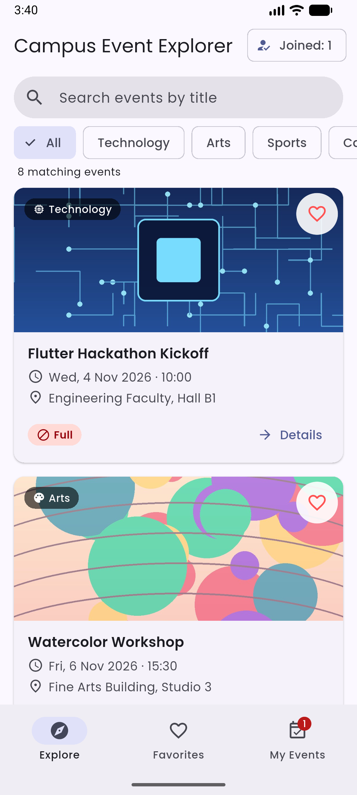
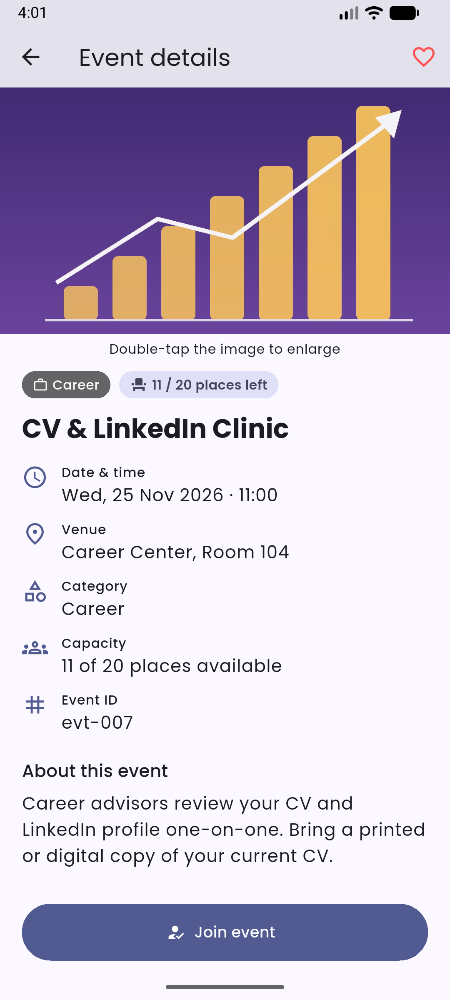
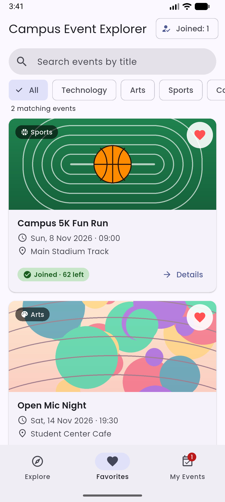
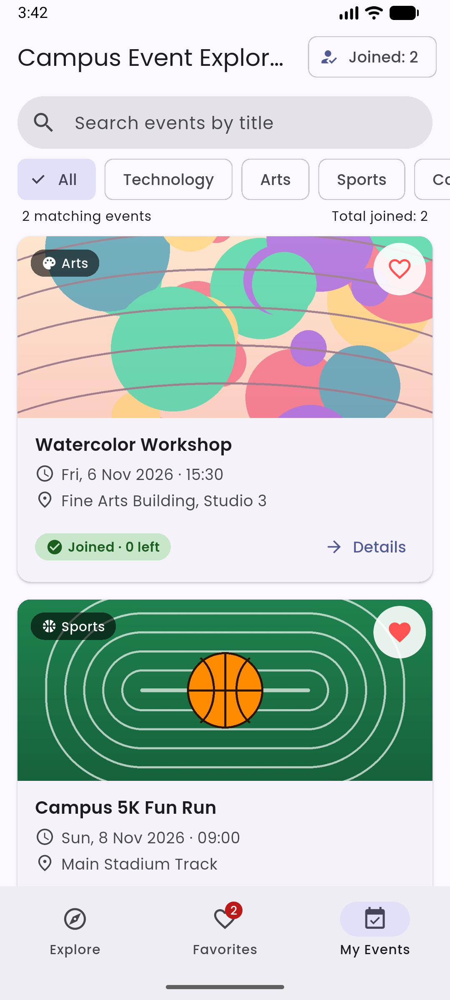
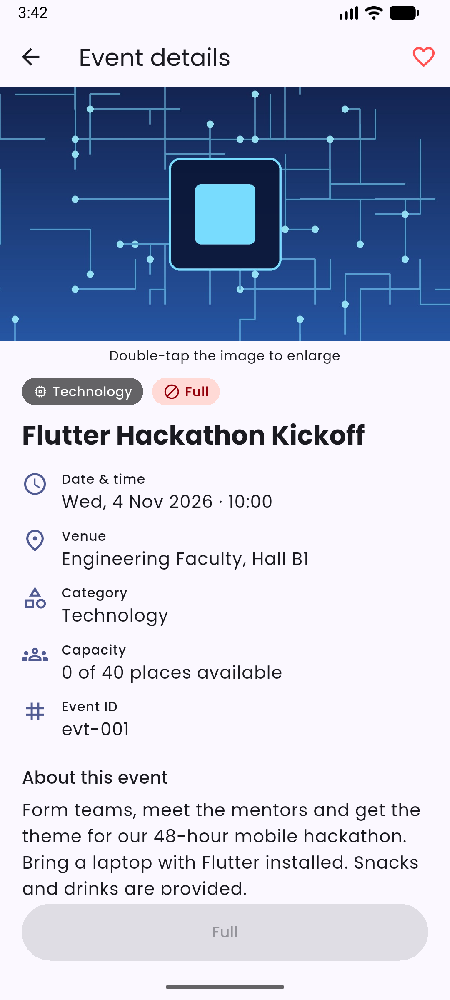
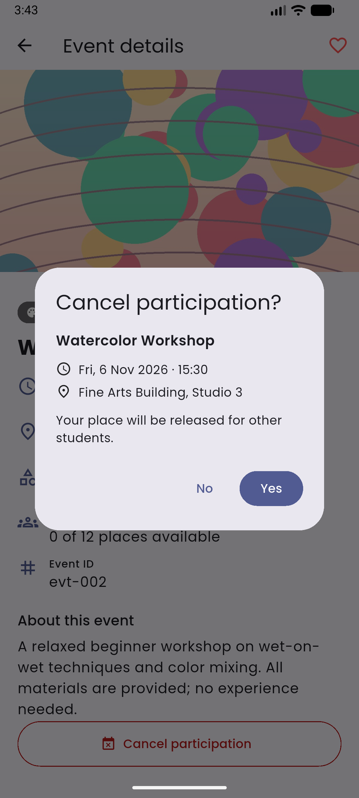
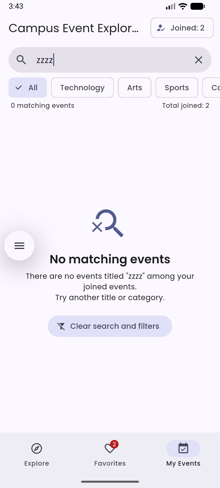

# Campus Event Explorer

BIM493 – Mobile Programming I · Assignment #1 (2026–2027)

A Flutter app that helps students discover campus events, save favorites and
manage their own participation. All data is fictional and stored in Dart code;
the app works fully offline.

## Team

| Full name | Student ID | Contribution |
|-----------|------------|--------------|
| Kerem Gönültaş | 10345423990 | Data model, join/cancel logic and capacity rules, event details screen, confirmation dialogs |
| Mert Halitoğlu | 10304265012 | Explore screen and cards, search & category filter, Favorites/My Events views, assets & font, README and screenshots |

## Flutter version

```
Flutter 3.47.6 • channel stable • https://github.com/flutter/flutter.git
Framework • revision 5fc346839b (4 weeks ago) • 2026-09-30 15:02:49 -0700
Engine • hash b8c8d3d8d5d0095127057f8a29ca8cc53da2167c (revision 692136cb65) (25 days ago) • 2026-09-30 00:56:59.000Z
Tools • Dart 3.13.5 • DevTools 2.60.0
```

## Setup and run

```bash
# inside the project folder
flutter create . --project-name campus_event_explorer --platforms android   # only if android/ is missing
flutter pub get
flutter analyze
flutter test
flutter run            # with an emulator or device connected
```

## Features

- **Explore** – 8 fictional events in 4 categories (Technology, Arts, Sports, Career),
  scrollable cards with image, title, category, date/time, venue, availability label,
  favorite button and a Details button.
- **Search + category filter** – title search ignores letter case and surrounding
  spaces; All + 4 category chips; both work together and the number of matching
  events is shown. A clear (×) button empties the search. The same search/filter
  applies to Explore, Favorites and My Events.
- **Empty states** – "No matching events" (with a *Clear search and filters* button),
  "No favorites yet", "You have not joined any events".
- **Details screen** – all event information, favorite button, participation button.
  **Double-tap the image** to open an enlarged, zoomable image screen. Back
  navigation works on both screens and the previous screen shows updated state.
- **Join / cancel** – confirmation dialog showing title, date/time and venue with
  Yes/No. *No* or dismissing changes nothing. *Yes* joins once, decreases available
  places by one and shows a SnackBar. Joined events show *Cancel participation*
  (also confirmed), which restores one place. Joined IDs are kept in a `Set`, so
  repeated joins cannot create duplicates. Unjoined events with 0 places show
  **Full** and the button is disabled; a student who took the last place can still
  cancel. Total joined events are shown in the app bar and the My Events badge.
- **State** – a plain Dart `EventStore` object shared by all screens, updated with
  `setState`. Favorites and participation reset when the app restarts.

### Sample data rules

| Rule | Event |
|------|-------|
| Initially full (0 places) | Flutter Hackathon Kickoff (40 / 0) |
| Exactly one place | Watercolor Workshop (12 / 1) |
| Dates after deadline | 4 Nov 2026 – 3 Dec 2026 |

## Project structure

```
lib/
  main.dart                      MaterialApp, theme, custom font
  models/campus_event.dart       CampusEvent model + EventCategory enum
  data/events_data.dart          fictional events + image paths
  data/event_store.dart          favorites, join/cancel logic, shared filter
  screens/home_screen.dart       StatefulWidget: tabs, search, filter, lists
  screens/event_details_screen.dart  StatefulWidget: details, favorite, join/cancel
  screens/image_viewer_screen.dart   enlarged image (InteractiveViewer)
  widgets/event_card.dart        StatelessWidget card (+ InfoRow, CategoryBadge)
  widgets/availability_chip.dart
  widgets/search_filter_bar.dart
  widgets/empty_state.dart
  utils/formatters.dart          date/time + availability text
  utils/participation_dialogs.dart  Yes/No dialog + SnackBar helper
assets/images/                   4 category images (reused per category)
assets/fonts/                    Poppins font + OFL.txt license
test/widget_test.dart            unit + widget tests
docs/screenshots/                screenshots used below
```

## Screenshots

| Explore | Details | Favorites | My Events |
|---------|---------|-----------|-----------|
|  |  |  |  |

| Full event | Cancel dialog | Empty search |
|------------|---------------|--------------|
|  |  |  |

## Test checklist

- [x] **Full event** – "Flutter Hackathon Kickoff" shows *Full* on its card and a disabled *Full* button in details.
- [x] **Last place** – joining "Watercolor Workshop" makes it 0 places left; *Cancel participation* still works and restores 1 place.
- [x] **Join dialog** – shows title, date/time and venue; *No* and tapping outside change nothing.
- [x] **Cancel dialog** – confirmation appears; *Yes* removes the event from My Events and restores one place.
- [x] **No duplicates** – joined count increases by one only; a joined event cannot be joined again.
- [x] **Empty search** – typing `zzzz` shows "No matching events" and *0 matching events*; × / *Clear search and filters* restores the list.
- [x] **Case/space-insensitive search** – `  WATERCOLOR ` finds Watercolor Workshop.
- [x] **Search + category together** – "watercolor" + Sports shows the empty state.
- [x] **Favorites** – toggling the heart on a card or in details updates Explore, Favorites and details; capacity does not change.
- [x] **Image viewer** – double-tap on the details image opens the enlarged image; Back returns.
- [x] `flutter test` passes.

## Credits and licenses

- **Images** (`assets/images/*.jpg`): original abstract illustrations generated
  programmatically for this project; no third-party content.
- **Font**: [Poppins](https://github.com/itfoundry/Poppins) by the Poppins Project
  Authors (Indian Type Foundry), licensed under the SIL Open Font License 1.1.
  The license is included at `assets/fonts/OFL.txt`. Files obtained from the
  [google/fonts](https://github.com/google/fonts/tree/main/ofl/poppins) repository
  and bundled locally (no internet needed).
- Icons: Material Icons included with Flutter.

## Known limitations

- Favorites and participation are kept in memory only and reset when the app restarts (allowed by the assignment).
- No login, backend, database or real booking.
- Event dates are fixed; past events are not hidden automatically.
- UI text is English only.
